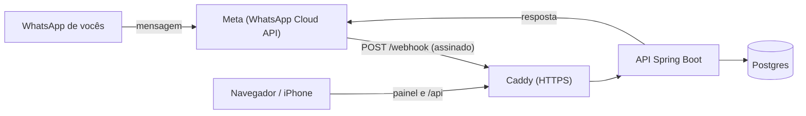

# GastosXP 💸

Controle de gastos pessoal: um site que abre como app no iPhone, com o **gasto do dia**, da semana e do mês, categorias, orçamento e dicas de onde dá pra economizar. Também tem um bot de WhatsApp: você manda **"45,90 lanche porque não deu tempo"** e ele anota.

> **Situação atual (out/2026):** o site está no ar em https://caderneta-zap.onrender.com (Render + Neon, grátis). O bot de WhatsApp está pronto e configurado, mas a Meta trava contas novas até a **Verificação da Empresa** (erro 131031, "Business Account locked"). Quando a verificação sair, o bot passa a funcionar sem mudar código.

Feito em **Java 21 + Spring Boot 3.5**, com a **WhatsApp Cloud API** oficial da Meta.



## O que tem aqui

- **Bot no WhatsApp**: entende valor, descrição, motivo, categoria (#tag), datas ("ontem", "15/10") e horários ("às 19h"). Responde resumos, extrato, dicas e aceita "apagar" para desfazer.
- **Painel web** (tema escuro, abre bem no iPhone e dá pra pôr na tela de início): total do **dia**, da semana ou do mês, comparação com o período anterior, orçamento (no dia e na semana vale a parte proporcional do mês), gasto por categoria e por pessoa, dicas e a lista de anotações com edição.
- **API REST** com login, CSRF e erros no formato Problem Details.
- **Dicas automáticas**: alerta de orçamento estourado, projeção do mês no ritmo atual, categoria que disparou, gastos pequenos que somam muito e quanto dá pra economizar cortando 30% do que é supérfluo.

## Estrutura

```
src/main/java/br/com/caderneta/
├── nucleo/      regras puras, sem Spring: leitura das mensagens, períodos, resumo, dicas e textos do bot
├── gasto/       entidade, repositório, serviço e REST de gastos
├── orcamento/   orçamento mensal
├── resumo/      resumo da semana/mês para o painel
├── whatsapp/    webhook da Meta, assinatura HMAC, cliente da Graph API, bot e simulador
├── config/      segurança e configurações
└── web/         tratamento de erros da API
src/main/resources/static/   painel (index.html) e login
deploy/                      Caddyfile e scripts da VM
postman/                     coleção pronta para testar a API
```

O pacote `nucleo` não depende de framework nenhum, então os testes dele rodam em milissegundos e cobrem os casos chatos: "1.234,56", "R$45", celular sem o nono dígito, semana que atravessa o mês, comparação "até o mesmo ponto" da semana passada.

## Rodando no seu PC

Precisa de JDK 21. O jeito mais fácil é pelo **IntelliJ**, que já vem com o Maven:

1. **File → Open** e escolha esta pasta (a que tem o `pom.xml`).
2. Abra o painel **Maven** (o "m" na barra da direita).
3. Testes: **caderneta-zap → Lifecycle → verify** (dois cliques). Tem que terminar em **BUILD SUCCESS**.
4. Subir o sistema: **Plugins → spring-boot → spring-boot:run** (dois cliques). Ele já sobe no perfil `local`, configurado no `pom.xml`.
5. Quando aparecer `Started CadernetaApplication`, abra http://localhost:8080 e entre com **thiago / local123**.

> Não use a setinha verde ao lado dos comandos neste README dentro do IntelliJ: ela manda as aspas do PowerShell pro Windows e dá "A sintaxe do comando está incorreta".

Pelo terminal, se tiver o Maven instalado:

```powershell
mvn verify
mvn spring-boot:run
```

O perfil `local` usa um banco H2 em arquivo (pasta `dados/`), então não precisa instalar banco nenhum. Pra zerar os dados de teste, pare o sistema e apague a pasta `dados/`.

Para conversar com o bot **sem WhatsApp**, importe `postman/caderneta-zap.postman_collection.json` no Postman, rode "1. Abrir login" e "2. Entrar", e use as requisições da pasta **Bot → Simulador**. A resposta é exatamente o texto que iria para o WhatsApp. Os números liberados no perfil local são `5511999999999` (Thiago) e `5511988888888` (Larissa).

## Comandos do bot

| Mensagem | O que acontece |
|---|---|
| `45,90 lanche` | Anota R$ 45,90 em "Lanche" (categoria Comida fora, deduzida sozinha) |
| `120 mercado porque acabou tudo` | Anota com motivo (também vale `-`, `pq`, `por que`) |
| `89,90 pizza #lazer ontem` | Escolhe a categoria e a data |
| `32 uber 15/10 às 19h` | Data e hora específicas |
| `semana` / `mês` | Resumo do período, com categorias, pessoas e uma dica |
| `semana passada` / `mês passado` | Resumo do período anterior |
| `hoje` | Gastos de hoje |
| `extrato` | Últimos 8 lançamentos |
| `apagar` | Desfaz o último gasto que **você** anotou |
| `dicas` | Até 3 dicas do mês |
| `orçamento 3000` | Define o orçamento do mês (`orçamento 0` remove) |
| `site` | Manda o link do painel |
| `ajuda` | Lista tudo isso |

Categorias para usar com `#`: mercado, comida, transporte, casa, saude, lazer, compras, assinaturas, outros.

## API

Tudo em `/api` exige login (sessão do painel) e, em POST/PUT/DELETE, o cabeçalho `X-XSRF-TOKEN` com o valor do cookie `XSRF-TOKEN`. A coleção do Postman já faz isso.

| Método | Caminho | Descrição |
|---|---|---|
| GET | `/api/resumo?periodo=semana&offset=0` | Resumo completo (`mes` também; `offset=-1` é o anterior) |
| GET | `/api/gastos?de=2026-10-01&ate=2026-10-31` | Lista gastos entre datas (padrão: mês atual) |
| GET | `/api/gastos/{id}` | Um gasto |
| POST | `/api/gastos` | Cria: `{"valorCentavos":4590,"descricao":"gasolina","motivo":"...","categoria":"TRANSPORTE","quando":"2026-10-18T10:00:00-03:00","autor":"Thiago"}` (só valor e descrição são obrigatórios) |
| PUT | `/api/gastos/{id}` | Atualiza |
| DELETE | `/api/gastos/{id}` | Apaga |
| GET / PUT | `/api/orcamento` | Consulta / define `{"valorMensalCentavos":300000}` |
| GET | `/api/info` | Categorias, pessoas e se o WhatsApp está configurado |
| POST | `/api/simulador` | `{"de":"5511999999999","texto":"semana"}` (só no perfil local) |
| GET / POST | `/webhook` | Usado pela Meta |
| GET | `/actuator/health` | Saúde da aplicação (público) |

Valores sempre em **centavos** para não ter erro de arredondamento.

---

## No ar sem cartão: Render + Neon

O caminho mais simples, e o que está em uso: o **Render** roda a aplicação a partir do GitHub e o **Neon** guarda o banco Postgres. Os dois têm plano grátis sem cartão e dá pra entrar com a conta do GitHub.

1. **Neon** ([neon.com](https://neon.com)): crie um projeto na região **AWS US East 1 (N. Virginia)** e copie a *connection string* (`postgresql://...`).
2. **Render** ([render.com](https://render.com)): **New → Web Service → Public Git Repository** com a URL deste repositório. Ele detecta o `Dockerfile`. Região **Virginia** (perto do banco), plano **Free**.
3. Variáveis de ambiente no Render:

| Variável | Valor |
|---|---|
| `DATABASE_URL` | a connection string do Neon, do jeito que vem (`postgresql://...`) |
| `PAINEL_USUARIO` / `PAINEL_SENHA` | login do painel |
| `SITE_URL` | o endereço que o Render der, ex.: `https://caderneta-zap.onrender.com` |
| `PESSOAS` | `5511999999999=Thiago,5511988888888=Larissa` |
| `WHATSAPP_*` | os quatro valores da Meta (passo 5 abaixo) |

A aplicação entende o formato `postgresql://` do Neon sozinha e já usa a conexão direta, sem o `-pooler`. No plano grátis, o Render hiberna depois de 15 minutos sem uso. A primeira mensagem depois disso leva cerca de 1 minuto pra ser respondida (a Meta reenvia), e as próximas saem na hora. O "continuar conectado" do painel sobrevive às hibernações.

## Alternativa: VM própria na Oracle Cloud

### Colocando no ar (de graça)

O caminho: **GitHub** guarda o código → **Oracle Cloud** roda uma VM grátis → **DuckDNS** dá um endereço grátis → **Caddy** coloca HTTPS → **Meta** manda as mensagens para o seu `/webhook`.

### 1. Suba o código para o GitHub

Crie um repositório **privado** e envie esta pasta:

```powershell
git init
git add .
git commit -m "Caderneta Zap"
git branch -M main
git remote add origin https://github.com/SEU_USUARIO/caderneta-zap.git
git push -u origin main
```

O GitHub Actions (`.github/workflows/ci.yml`) roda os testes a cada push.

### 2. Crie a VM na Oracle Cloud

1. Crie a conta em [oracle.com/cloud/free](https://www.oracle.com/cloud/free/) (pede cartão para verificação, mas os recursos "Always Free" não são cobrados). Escolha a região **São Paulo** como região principal.
2. **Compute → Instances → Create instance**:
   - Imagem: **Ubuntu 24.04** (ou 22.04).
   - Shape: **VM.Standard.A1.Flex** com 2 OCPUs e 12 GB (o melhor do plano grátis). Se aparecer "out of capacity", tente outro domínio de disponibilidade, tente mais tarde, ou use **VM.Standard.E2.1.Micro** (1 GB, funciona com o swap que o script cria).
   - Baixe a chave SSH que ela gerar.
3. Anote o **IP público** da instância.
4. Libere as portas na rede: na página da instância, clique na **Subnet → Security List → Add Ingress Rules**, origem `0.0.0.0/0`, protocolo TCP, portas **80** e depois **443**.

> A Oracle pode recuperar instâncias grátis que ficam ociosas por 7 dias seguidos (CPU, rede e memória abaixo de 20%). Para evitar, dá pra fazer upgrade da conta para "Pay As You Go": os recursos Always Free continuam sem cobrança. Se fizer isso, crie um alerta de orçamento de R$ 1 em **Billing → Budgets** para ser avisado de qualquer cobrança. Os backups (passo 7) garantem que você não perde dados de qualquer jeito.

### 3. Pegue um endereço no DuckDNS

1. Entre em [duckdns.org](https://www.duckdns.org) com sua conta Google ou GitHub.
2. Crie um subdomínio (ex.: `caderneta-thiago`) e coloque o **IP público** da VM no campo *current ip*.
3. Seu endereço vira `caderneta-thiago.duckdns.org`.

### 4. Suba o sistema na VM

No PowerShell do seu PC (troque o caminho da chave e o IP):

```powershell
ssh -i C:\caminho\da\chave.key ubuntu@IP_DA_VM
```

Já na VM:

```bash
git clone https://github.com/SEU_USUARIO/caderneta-zap.git
cd caderneta-zap
bash deploy/preparar-vm.sh
exit
```

Entre de novo pelo SSH e configure:

```bash
cd caderneta-zap
cp .env.example .env
nano .env
```

Preencha por enquanto `DOMINIO`, `DB_SENHA`, `PAINEL_SENHA`, `PAINEL_LEMBRAR_CHAVE` e `PESSOAS` (os campos do WhatsApp vêm no passo 5). Para gerar senhas: `openssl rand -hex 24`. Salve com Ctrl+O, Enter, Ctrl+X.

```bash
docker compose up -d --build
docker compose logs -f app
```

A primeira compilação leva alguns minutos. Quando aparecer `Started CadernetaApplication`, abra `https://SEU_DOMINIO` no navegador: deve aparecer a tela de login (o Caddy tira o certificado HTTPS sozinho no primeiro acesso).

### 5. Configure o WhatsApp na Meta

1. Entre em [developers.facebook.com](https://developers.facebook.com) com seu Facebook e clique em **Criar app**. Escolha o caso de uso **Conectar-se com clientes pelo WhatsApp** e crie (ele pede para criar ou escolher um portfólio empresarial; pode ser no seu nome).
2. Em **WhatsApp → Configuração da API**:
   - A Meta dá um **número de teste** gratuito. Copie o **ID do número de telefone** → `WHATSAPP_PHONE_NUMBER_ID`.
   - Em **Para**, adicione o seu celular e o da sua esposa (cada um recebe um código para confirmar). O número de teste só conversa com números cadastrados aqui.
3. **Token permanente** (o token da tela expira em 24 h):
   - Vá em **Configurações do negócio → Usuários → Usuários do sistema → Adicionar**, função **Administrador**.
   - **Atribuir ativos**: o seu app (controle total) e a conta do WhatsApp (controle total).
   - **Gerar token**, escolha o app, validade **Nunca** e marque `whatsapp_business_messaging`, `whatsapp_business_management` e `business_management`. Copie → `WHATSAPP_TOKEN`.
4. **Chave secreta**: **Configurações do app → Básico → Chave secreta do app → Mostrar** → `WHATSAPP_APP_SECRET`.
5. Invente um texto qualquer para `WHATSAPP_VERIFY_TOKEN` (ex.: `caderneta-2026-xyz`).
6. Atualize o `.env` na VM com os quatro valores e reinicie: `docker compose up -d`.
7. Em **WhatsApp → Configuração → Webhook**:
   - **URL de callback**: `https://SEU_DOMINIO/webhook`
   - **Token de verificação**: o mesmo `WHATSAPP_VERIFY_TOKEN`
   - Clique em **Verificar e salvar**, depois em **Gerenciar** os campos do webhook e assine **messages**.

### 6. Teste

Salve o número de teste da Meta nos contatos e mande **ajuda**. Depois, **45,90 lanche**. O gasto aparece no painel em até 30 segundos.

Sobre custo: o bot só responde mensagens que vocês mandam, dentro da janela de 24 h. Desde 1º de outubro de 2026, cada número tem **1.000 respostas grátis por mês** nesse tipo de conversa, muito acima do uso de um casal.

### 7. Backup e atualização

```bash
# backup manual (fica em backups/)
bash deploy/backup.sh

# backup automático todo dia às 3h
crontab -e
# adicione a linha:
0 3 * * * /home/ubuntu/caderneta-zap/deploy/backup.sh >> /home/ubuntu/backup.log 2>&1

# restaurar um backup (ATENÇÃO: troca os dados atuais pelos do backup)
docker compose down
docker volume rm caderneta-zap_dados-postgres
docker compose up -d db && sleep 10
gunzip -c backups/caderneta-2026-10-18.sql.gz | docker compose exec -T db psql -U caderneta caderneta
docker compose up -d

# publicar uma versão nova depois de dar push no GitHub
bash deploy/atualizar.sh
```

Vale copiar a pasta `backups/` para fora da VM de vez em quando (`scp` para o seu PC).

## Problemas comuns

| Sintoma | O que fazer |
|---|---|
| Meta não verifica o webhook | Confira se `https://SEU_DOMINIO` abre no navegador e se o token na Meta é igual ao `WHATSAPP_VERIFY_TOKEN`. Veja `docker compose logs app`. |
| Log: "assinatura ausente ou inválida" | `WHATSAPP_APP_SECRET` errado. |
| Log: "o número X não está em PESSOAS" | Copie o número exatamente como aparece no log para a variável `PESSOAS` e rode `docker compose up -d`. |
| Log: "A Meta recusou a resposta… 131030" | O número não está na lista "Para" do número de teste. Cadastre de novo; com celular brasileiro às vezes é preciso cadastrar **sem o 9** depois do DDD. |
| Log: "A Meta recusou… 190" ou "expired" | Token vencido. Use o token do usuário do sistema (passo 5.3). |
| Site não abre / certificado | Portas 80 e 443 liberadas na Security List? O DuckDNS aponta para o IP certo? `docker compose logs caddy` mostra o motivo. |
| VM de 1 GB travando | No `.env`, coloque `JAVA_OPTS=-Xmx256m -XX:+UseSerialGC` e rode `docker compose up -d`. |

## Segurança

- Cada chamada do webhook é conferida pela assinatura **HMAC-SHA256** da Meta (`X-Hub-Signature-256`). Sem a chave secreta, ninguém consegue inserir gastos.
- Só os números em `PESSOAS` conseguem anotar. Mensagens repetidas pela Meta não duplicam (ID da mensagem único no banco).
- Painel com login, proteção CSRF, cookie "continuar conectado" e cabeçalho de Content-Security-Policy.
- Senhas e tokens ficam só no `.env` da VM, que não vai para o Git.

## Próximos passos

- Trocar o número de teste por um número próprio (um chip que não esteja em uso no app do WhatsApp).
- Domínio próprio em vez do DuckDNS.
- Exportar CSV, metas por categoria, aviso automático no domingo com o resumo da semana (precisa de mensagem template aprovada pela Meta).
